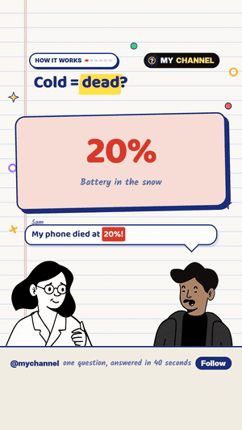
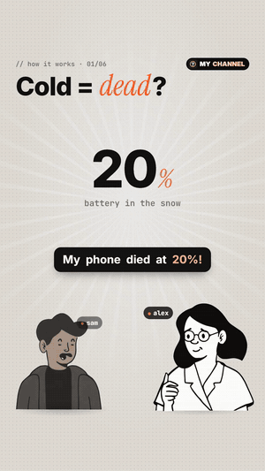

<div align="center">


# ShortPilot

**आपका faceless Shorts चैनल, autopilot पर।**<br>
Trending topic → research वाली script → animated 9:16 video → YouTube Shorts, Instagram Reels और Facebook Reels।<br>
आप Telegram से approve करते हैं, बाकी सब ShortPilot करता है। किसी भी भाषा में, आपके PC पर या cloud में free।

[English](README.md) · **हिन्दी**


&nbsp;&nbsp;


<sub>दोनों clips एक ही script से <code>python autopilot.py demo</code> ने बनाए हैं: न API key, न stock footage, voice आपके PC पर।</sub>

</div>

**▶ आवाज़ के साथ देखें** (voice, music और sound effects सब आपके PC पर बनते हैं):

https://github.com/user-attachments/assets/d0f3a935-226e-487e-85a5-0124d71a7363

---

## शुरू कैसे करें

**Coding नहीं आती?** कोई एक तरीका चुनें। दोनों के आखिर में आपकी screen पर demo video चलेगा।

1. **Claude से setup करवाएं।** [Claude Code](https://claude.com/claude-code) install करें (desktop app या
   terminal), किसी खाली folder में खोलें और यह paste करें:

   > Install ShortPilot from https://github.com/deeppatel99/shortpilot, set it up and render the demo video.

   Claude download करेगा, setup चलाएगा, जो कमी है उसे ठीक करेगा और बताएगा कि video कहाँ है। उसके बाद बस बात
   करते रहें: *"मेरा चैनल Hindi में space facts के बारे में बना दो"*।
2. **Windows: double-click।** इस page पर **Code → Download ZIP** दबाएं, ZIP खोलें, और **`setup.bat`** पर
   double-click करें। Windows पूछे तो **Run** (या **More info → Run anyway**) दबाएं। करीब 10 मिनट में demo video
   खुल जाएगा।

**Terminal चलाना आता है?** नीचे [Quickstart](#quickstart) देखें।

## क्या-क्या करता है

| | |
|---|---|
| 🔎 **Topic ढूंढता है** | Google Trends, Google News, YouTube trending, Hacker News, GitHub, और आपके niche के हिसाब से LLM ranking |
| ✍️ **Script लिखता और जाँचता है** | Hook, कहानी, sources और CTA। गलत output render होने से *पहले* ठीक या reject होता है |
| 🎬 **Animated video, stock clips नहीं** | Motion graphics, दो animated characters, word-by-word captions, music और SFX |
| 🗣️ **कोई भी भाषा** | `content.language` में `hi-IN`, `en-US`, `es-MX`… Kokoro (free, local) या Azure (140+ भाषाएं), Indian भाषाओं के लिए Sarvam |
| 📱 **हर जगह publish** | YouTube Shorts (schedule के साथ), Instagram Reels, Facebook Reels, पहला comment भी |
| ✅ **फैसला आपका** | Telegram पर approve, बदलाव, topic बदलें या reject करें। चाहें तो full auto mode |
| ☁️ **$0 cloud mode** | GitHub Actions + Cloudflare Worker, एक command से setup। PC बंद रह सकता है |
| 🤖 **Claude Code plugin** | बोलिए *"make a short about why the sky is blue"* और Claude पूरा pipeline चलाता है |

## Quickstart

```bash
git clone https://github.com/deeppatel99/shortpilot && cd shortpilot

# 1) install: Python venv, Chromium, FFmpeg, Kokoro voice model (~350 MB)
bash setup.sh                                          # macOS / Linux
powershell -ExecutionPolicy Bypass -File .\setup.ps1   # Windows (या setup.bat पर double-click)

# 2) बिना key के demo video
.venv/bin/python autopilot.py demo                     # Windows: .venv\Scripts\python.exe autopilot.py demo

# 3) अपना चैनल
.venv/bin/python autopilot.py new-channel mychannel
#    channels/mychannel/channel.json में niche, audience, भाषा ("hi-IN"), schedule भरें
.venv/bin/python autopilot.py make --topic "हवाई जहाज़ की खिड़कियाँ गोल क्यों होती हैं"
```

Video `channels/mychannel/data/videos/` में मिलेगा। Telegram approvals और auto-posting के लिए
**[docs/QUICKSTART.md](docs/QUICKSTART.md)** (करीब 15 मिनट) और फिर **[docs/SETUP.md](docs/SETUP.md)** देखें।

## Claude Code से चलाएं

```text
/plugin marketplace add deeppatel99/shortpilot
/plugin install shortpilot@shortpilot
```

Codex, Cursor, Gemini CLI या कोई भी Agent Skills वाला tool:

```bash
npx skills add deeppatel99/shortpilot
```

फिर बस बोलिए: *"Set up ShortPilot for a Hindi motivation channel"* · *"Make a short about Chandrayaan-3"* ·
*"कल का render fail क्यों हुआ?"*

## आम सवाल

**पैसे लगते हैं?** Default setup में नहीं। Script आपके Claude plan वाले Claude Code CLI से बनती है, Kokoro voice
आपके PC पर चलती है, और cloud mode GitHub Actions और Cloudflare के free tier में आ जाता है।

**GPU चाहिए?** नहीं। CPU पर render होता है: laptop पर 30 सेकंड का short करीब 1 मिनट में।

**YouTube इसे spam मानेगा?** इसीलिए approval default में on है। हर script के sources होते हैं, आप render से पहले
पढ़ते हैं, और upload पर YouTube का "altered or synthetic content" label लगता है। ऐसे videos बनाइए जिन पर आपको
गर्व हो।

## Docs (English)

[QUICKSTART](docs/QUICKSTART.md) · [SETUP](docs/SETUP.md) · [CONFIGURATION](docs/CONFIGURATION.md) ·
[CLOUD](docs/CLOUD.md) · [OPERATIONS](docs/OPERATIONS.md) · [ARCHITECTURE](docs/ARCHITECTURE.md)

## License

[MIT](LICENSE)। अच्छे videos बनाइए और बताइए कि जानकारी कहाँ से आई।

<div align="center">

**ShortPilot से आपका समय बचे, तो एक ⭐ दीजिए, ताकि बाकी creators भी इसे ढूंढ सकें।**

</div>
