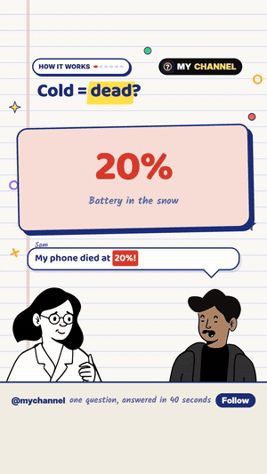
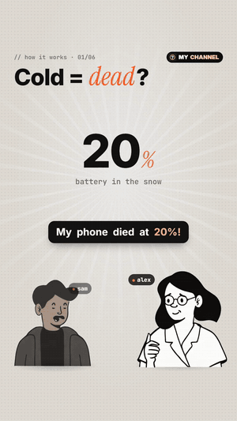
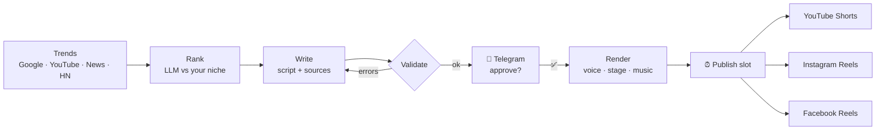

<div align="center">


# ShortPilot

**Your faceless Shorts channel on autopilot.**<br>
Trending topic → researched script → animated 9:16 video → YouTube Shorts, Instagram Reels and Facebook Reels.<br>
You approve from Telegram. It handles everything else, in any language, on your PC or free in the cloud.

[](https://github.com/deeppatel99/shortpilot/actions/workflows/ci.yml)
[](LICENSE)
[](https://www.python.org)
[](#use-it-from-claude-code)
[](#other-agents-codex-cursor-gemini-cli)
[](CONTRIBUTING.md)

[Start here](#start-here) · [Quickstart](#quickstart) · [Features](#features) · [How it works](#how-it-works) · [Docs](#documentation) · [FAQ](#faq)

**English** · [हिन्दी](README.hi.md)


&nbsp;&nbsp;


<sub>Both clips were rendered from the same script by <code>python autopilot.py demo</code>: no API keys, no stock footage, local voice.</sub>

</div>

---

## Start here

**Not a coder?** Pick one. Both end with a demo video playing on your screen.

1. **Let Claude set it up.** Install [Claude Code](https://claude.com/claude-code) (desktop app or terminal), open
   it in an empty folder and paste:

   > Install ShortPilot from https://github.com/deeppatel99/shortpilot, set it up and render the demo video.

   Claude downloads it, runs the setup, fixes anything missing and tells you where the video is. Afterwards just
   keep talking to it: *"make my channel about space facts in Hindi"*.
2. **Windows: double-click.** On this page click **Code → Download ZIP**, unzip it, and double-click
   **`setup.bat`**. If Windows asks whether to run it, click **Run** (or **More info → Run anyway**). In about
   10 minutes the demo video opens.

**Comfortable with a terminal?** Go to [Quickstart](#quickstart).

## Why ShortPilot

Most "AI video generators" stop at an MP4 with a stock clip and a robot voice. Running a channel takes more than
that: picking topics that are trending today, checking the facts, keeping a consistent look, posting at the right
hour, replying to comments, and doing it again tomorrow.

ShortPilot runs that whole loop and keeps you in charge of the one thing that matters, **what goes out under your
name**. Each morning it sends a script with its sources to Telegram. You check it and tap ✅, and the finished
video posts itself at your publish time.

## Features

| | |
|---|---|
| 🔎 **Finds topics** | Google Trends, Google News, YouTube trending, Hacker News and GitHub, ranked by an LLM against your niche |
| ✍️ **Writes and checks scripts** | Hook, story, sources and a CTA. A validator fixes or rejects bad output *before* anything renders |
| 🎬 **Animated video, not stock slop** | Motion graphics in two looks (notebook, editorial), an animated two-person cast, word-by-word captions, 13 visual types, generated music and SFX, −14 LUFS loudness |
| 🗣️ **Any language** | Set `content.language` to `en-US`, `es-MX`, `pt-BR`, `fr-FR`, `hi-IN`, `ja-JP`… Kokoro (free, local) or Azure (140+ languages) |
| 📱 **Publishes everywhere** | YouTube Shorts (scheduled with `publishAt`, AI label set), Instagram Reels and Facebook Reels, with a first comment |
| ✅ **Human in the loop** | Approve, request changes, change topic or reject from Telegram. Or switch on full auto mode |
| ☁️ **$0 cloud mode** | GitHub Actions plus a Cloudflare Worker, set up with one command. Your PC can stay off |
| 🧩 **Many channels, one engine** | Each channel is a folder: `channel.json`, prompts, logo and keys. Fork a niche in a minute |
| 🤖 **Claude Code plugin** | Say *"make a short about why the sky is blue"* and Claude drives the whole pipeline |
| 💸 **Uses the plan you already have** | Scripts come from the Claude Code CLI on your Claude plan. Gemini's free tier and the Claude API are fallbacks |

## Quickstart

```bash
git clone https://github.com/deeppatel99/shortpilot && cd shortpilot

# 1) install: Python venv, Chromium, FFmpeg check, Kokoro voice model (~350 MB)
bash setup.sh                                          # macOS / Linux
powershell -ExecutionPolicy Bypass -File .\setup.ps1   # Windows (or double-click setup.bat)

# 2) see it work: renders a demo short, no keys needed
.venv/bin/python autopilot.py demo                     # Windows: .venv\Scripts\python.exe autopilot.py demo

# 3) your channel
.venv/bin/python autopilot.py new-channel mychannel
#    edit channels/mychannel/channel.json (niche, audience, language, schedule)
.venv/bin/python autopilot.py make --topic "why airplane windows are round"
```

That's a finished video in `channels/mychannel/data/videos/`. To get daily approvals in Telegram and automatic
posting, follow **[docs/QUICKSTART.md](docs/QUICKSTART.md)** (about 15 minutes) and then
**[docs/SETUP.md](docs/SETUP.md)** for each platform.

## Use it from Claude Code

ShortPilot ships as a Claude Code plugin with a skill that knows the whole pipeline:

```text
/plugin marketplace add deeppatel99/shortpilot
/plugin install shortpilot@shortpilot
```

Then just ask:

> *"Set up ShortPilot for a Spanish cooking-tips channel"* · *"Make a short about the Mariana Trench"* ·
> *"Why did yesterday's render fail?"* · *"Move my channel to the cloud"*

Claude reads [`skills/shortpilot/SKILL.md`](skills/shortpilot/SKILL.md), runs the right commands, edits
`channel.json` for you and checks each step.

### Other agents (Codex, Cursor, Gemini CLI…)

The skill follows the open [Agent Skills](https://agentskills.io) format, so any agent that supports skills can
drive ShortPilot the same way:

```bash
npx skills add deeppatel99/shortpilot
```

## How it works



| Step | What happens | Code |
|---|---|---|
| Scout | Collects candidates from free sources and drops topics you already covered | [`pipeline/trends.py`](pipeline/trends.py) |
| Write | Ranks the topics, can research first, then writes an *episode JSON* (scenes, lines, visuals, sources) | [`pipeline/writer.py`](pipeline/writer.py) |
| Validate | Checks length, visual fields, sources and voice text, and asks the LLM to repair errors (twice at most) | [`pipeline/validate.py`](pipeline/validate.py) |
| Render | TTS line by line → timeline → HTML stage captured frame by frame by Chromium → FFmpeg | [`engine/html_short.py`](engine/html_short.py) |
| Publish | YouTube Data API, Instagram Graph API and Facebook Pages API, with a first comment | [`pipeline/publish.py`](pipeline/publish.py) |
| Bot | Telegram approvals, a job queue, crash recovery and the schedule | [`autopilot.py`](autopilot.py) |

More in [docs/ARCHITECTURE.md](docs/ARCHITECTURE.md).

## A channel is a folder

```
channels/mychannel/
├── channel.json     who you are: niche, audience, language, schedule, voice, look, trend sources, publish switches
├── prompts/         how topics are ranked, researched and written (edit these to change the content)
├── assets/          logo_icon.png and, optionally, chars/host.svg and chars/guest.svg for your own cast
├── .env             this channel's keys (never committed)
└── data/            videos, logs, bot state (never committed)
```

```jsonc
// channel.json (excerpt)
{
  "channel":  { "name": "My Channel", "handle": "@mychannel", "niche": "...", "audience": "..." },
  "content":  { "language": "es-MX", "categories": { "myth_check": "a popular belief tested..." } },
  "schedule": { "utc_offset": "-06:00", "scout_at": "08:00", "publish_at": "12:00" },
  "voice":    { "tts": "kokoro", "voice": "ef_dora" },
  "render":   { "engine": "html", "stage": "editorial", "cast_names": { "host": "Ana", "guest": "Leo" } },
  "publish":  { "auto": false }
}
```

Every key is explained in [docs/CONFIGURATION.md](docs/CONFIGURATION.md).

## Languages

The script, captions, voice, on-screen labels and trend region all follow `content.language`.

| Voice engine | Languages | Cost |
|---|---|---|
| **Kokoro** (default, runs locally) | English (US/UK), Spanish, French, Hindi, Italian, Japanese, Portuguese (BR), Mandarin | free |
| **Azure AI Speech** | 140+ languages and locales, 400+ voices | free tier: 500k chars/month |
| **Sarvam** | Indian languages | prepaid credits |

## Run it 24/7

| Mode | Command | Good for |
|---|---|---|
| **PC** | `./run_serve.sh` (Windows: `run_serve.bat`, or `install_task.ps1` to start at logon) | Trying it out, a machine that is always on |
| **Cloud** | `python autopilot.py cloud-setup` | Free and hands-off: GitHub Actions renders, a Cloudflare Worker receives the Telegram taps |

Cloud mode uses about 900 of the 2,000 free GitHub Actions minutes a month at one video a day. Details:
[docs/CLOUD.md](docs/CLOUD.md).

## Documentation

| Doc | What's in it |
|---|---|
| [QUICKSTART.md](docs/QUICKSTART.md) | Zero to your first approved video in Telegram |
| [SETUP.md](docs/SETUP.md) | Every key: Telegram, YouTube, Instagram, Facebook, Gemini, Cloudflare, stock media, Azure |
| [CONFIGURATION.md](docs/CONFIGURATION.md) | Every `channel.json` key, languages and voices, prompts |
| [CLOUD.md](docs/CLOUD.md) | GitHub Actions + Cloudflare Worker, secrets, free limits |
| [ARCHITECTURE.md](docs/ARCHITECTURE.md) | Modules, the episode JSON format, visual types, item states, adding a visual |
| [OPERATIONS.md](docs/OPERATIONS.md) | Telegram buttons and commands, daily routine, troubleshooting |

## FAQ

<details>
<summary><b>Does it cost anything?</b></summary>

No, if you use the defaults. Scripts come from the Claude Code CLI on your existing Claude plan, Kokoro voices
run locally, and the cloud mode fits the free tiers of GitHub Actions and Cloudflare. Pixabay, Cloudflare Workers
AI, Gemini and Azure Speech are optional and all have free tiers.
</details>

<details>
<summary><b>Will YouTube treat this as "mass-produced content"?</b></summary>

That is the reason approvals are on by default. Every script cites its sources, you read it before it renders, and
uploads carry YouTube's "altered or synthetic content" label. Use it to make videos you'd be proud to sign. It is
not meant for spam.
</details>

<details>
<summary><b>Can I use my own characters, fonts or look?</b></summary>

Yes. Put `host.svg` and `guest.svg` in `channels/<name>/assets/chars/`, pick `render.stage` (`stage` or
`editorial`), set your colours and wordmark in `channel.stage`, or copy `engine/web/stage.html` and design a new
stage. A stage is plain HTML, CSS and JS.
</details>

<details>
<summary><b>Do I need a GPU?</b></summary>

No. Rendering runs on the CPU (Chromium plus FFmpeg). A 30-second short takes about 1 minute on a laptop and 8 to
12 minutes on a free GitHub runner.
</details>

<details>
<summary><b>TikTok?</b></summary>

Not built in yet. The MP4 and caption are in `data/videos/` for manual upload. A TikTok publisher is the most
wanted contribution, see [CONTRIBUTING.md](CONTRIBUTING.md).
</details>

## Contributing

Bug reports, new visual types, stages, voices and publishers are all welcome. Read
[CONTRIBUTING.md](CONTRIBUTING.md). The offline test suite needs no keys and runs in about two minutes.

## Acknowledgements

[Kokoro](https://github.com/thewh1teagle/kokoro-onnx) (voice) · [Playwright](https://playwright.dev) (frame capture) ·
[FFmpeg](https://ffmpeg.org) · [DiceBear Notionists](https://www.dicebear.com/styles/notionists/) by Zoish (CC0 cast) ·
fonts under their own open licences in [`engine/assets/fonts`](engine/assets/fonts).

## License

[MIT](LICENSE). Make great videos and tell people where they came from.

<div align="center">

**If ShortPilot saves you time, a ⭐ helps other creators find it.**

[](https://star-history.com/#deeppatel99/shortpilot&Date)

</div>
