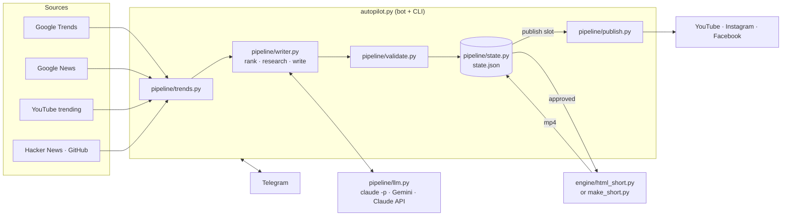

# Architecture

How ShortPilot is built, how a video moves through it, and where to change things.

## Components



| Module | Responsibility |
|---|---|
| [`autopilot.py`](../autopilot.py) | The `Autopilot` class: the approval flow (draft → render → schedule → publish), a background job queue, a render watchdog, Telegram update handling and crash recovery. It also holds every CLI command |
| [`pipeline/channel.py`](../pipeline/channel.py) | Resolves the active channel and serves its config, assets and stage texts. Standard library only, because the renderers import it too |
| [`pipeline/trends.py`](../pipeline/trends.py) | Collects topic candidates from free sources and de-duplicates them |
| [`pipeline/writer.py`](../pipeline/writer.py) | Ranks topics, optionally researches, writes the episode, and runs the validate → fix loop (at most 2 repairs). Falls back to a second LLM |
| [`pipeline/llm.py`](../pipeline/llm.py) | One interface, `complete(prompt, web=False) -> str`, over three providers |
| [`pipeline/validate.py`](../pipeline/validate.py) | Rejects what the renderer or the channel can't use, and auto-fixes safe things |
| [`pipeline/state.py`](../pipeline/state.py) | A JSON store with one record per video plus topic history. Writes are atomic |
| [`pipeline/telegram.py`](../pipeline/telegram.py) | A minimal Bot API client that only talks to `TELEGRAM_CHAT_ID` |
| [`pipeline/publish.py`](../pipeline/publish.py) | YouTube (upload, schedule, comment, stats), Instagram Reels (container → wait → publish → comment), Facebook Reels, and the public-URL host chain |
| [`pipeline/cloud.py`](../pipeline/cloud.py), [`cloud_setup.py`](../pipeline/cloud_setup.py) | GitHub Actions helpers (state branch, release assets, secrets) and the one-command cloud setup |
| [`engine/html_short.py`](../engine/html_short.py) | Episode JSON → MP4 using an HTML stage captured frame by frame in Chromium |
| [`engine/make_short.py`](../engine/make_short.py) | The shared core (normalising, TTS, timeline, music, SFX, mux) and the `classic` Pillow renderer |
| [`engine/media.py`](../engine/media.py) | Optional background shots: AI images and stock video/photos, cached. Every failure is non-fatal |
| [`engine/web/*.html`](../engine/web) | The stages: `stage.html` (notebook) and `stage_editorial.html` (print) |
| [`cloud/worker.js`](../cloud/worker.js) | Cloudflare Worker: answers Telegram instantly, forwards to GitHub, runs the crons and serves the privacy/terms pages |

## Episode JSON

The writer produces one JSON file per video, and every renderer reads the same format. A minimal example:

```json
{
  "title": "Why your phone dies at 20% in the cold #shorts",
  "topic": "Why phone batteries die faster in cold weather",
  "lang": "en-US",
  "category": "how_it_works",
  "sources": [{ "title": "Apple — Batteries", "url": "https://www.apple.com/batteries/maximizing-performance/" }],
  "cover": ["Phone died", "at *20%*?"],
  "cast": ["host", "guest"],
  "scenes": [
    {
      "accent": "#FF4D4D",
      "card": ["Cold = *dead*?"],
      "visual": { "type": "counter", "label": "Battery in the snow", "to": 20, "suffix": "%" },
      "lines": [
        { "who": "guest", "tts": "My phone died at twenty percent!", "cap": "My phone died at 20%!", "hi": ["20%!"] }
      ]
    }
  ],
  "yt_description": "…", "tags": ["…"], "ig_caption": "…", "pinned_comment": "…"
}
```

| Field | Meaning |
|---|---|
| `lines[].tts` | Exactly what the voice says (numbers spelled out, no emoji or URLs) |
| `lines[].cap` | The on-screen caption (digits allowed) |
| `lines[].hi` | 1–3 caption words to highlight |
| `card` | The scene heading, with one `*key*` word |
| `accent` | `#FF4D4D` danger · `#4DA3FF` info · `#FFB020` power · `#2BD67B` solution · `#B36BFF` question/CTA |
| `mood` | Optional, per character: `happy`, `shock`, `think`, `danger` or `neutral` |
| `bg` | Optional background shots: `[{"ai": "prompt"}]`, `[{"stock": "query"}]`, `[{"photo": "query"}]` |

[`engine/demo_episode.json`](../engine/demo_episode.json) is a complete example.

## Visual types

| Type | Required fields | What it shows |
|---|---|---|
| `headline` | `text` | A news-clipping headline |
| `breaking` | `text` | A breaking-news style banner |
| `big_emoji` | `emoji` | A reaction beat |
| `phone_msg` | `text` | A chat or SMS bubble with a stamp on line 2 |
| `lockscreen` | `items` | Up to 3 notifications, one per line |
| `myth_fact` | `claim`, `fact` | The myth gets crossed out and the fact is revealed |
| `versus` | `left`, `right` | Two options, with the winner on line 2 |
| `bars` | `items` | 2–4 bars that grow |
| `counter` | `to` | A number that counts up (`format`: `intl` or `indian` grouping) |
| `checklist` | `items` | One tick per spoken line |
| `setting` | `rows` | An app's settings screen with a toggle that flips |
| `terminal` | `rows` | A typing screen with a result |
| `photo` | `bg` | A polaroid of an AI image |
| `comment` | `text` | The closing comment prompt |
| `kinetic` | none | Full-screen kinetic typography of the first line (used for hooks) |

### Adding a visual type

1. Add it to `REQUIRED` in `pipeline/validate.py` (its required fields) and to `VISUAL_SPECS` in
   `engine/make_short.py`. The number there is how many lines the visual needs before its reveal.
2. Normalise its fields in `normalize()` in `make_short.py`, so a bad value can't crash a frame.
3. Draw it: add a `V.<type>` function in both `engine/web/*.html` stages, plus a branch in `draw_visual()` for the
   classic engine.
4. Document it in `channels/_template/prompts/episode.md`, so the writer can use it.
5. Add it to the generators in `tests/fuzz_render.py`.

## Rendering

1. **Voice.** Each line is synthesised separately (Kokoro, Azure or Sarvam) and cached by content hash, so
   captions are exactly in sync and re-renders cost nothing.
2. **Timeline.** Line timings give the scene boundaries. Those give each visual's anchor moments (a stamp lands on
   line 2, a counter runs) and the sound events that go with them, so picture and sound share one source of truth.
3. **Audio.** The voice, generated music with ducking, and synthesised SFX, normalised in two passes to −14 LUFS
   (the Shorts/Reels standard).
4. **Frames.** The `html` engine loads the stage in headless Chromium, sets the time and screenshots each frame.
   The `classic` engine draws each frame with Pillow. Both split the work across processes sized to free RAM and
   pipe frames into `libx264`.
5. **Mux.** The parts are concatenated with AAC audio and `+faststart`. Frame 0 becomes the cover image.

Retention rules built into the renderer: the hook is fully visible on frame 0, the spoken word is highlighted,
something moves every second, everything important stays inside the Shorts/Reels safe zone, and the last line
flows back into the first so the video loops.

## Design decisions

- **Human in the loop by default.** It catches wrong facts and keeps a channel clear of YouTube's
  "mass-produced content" policy.
- **The validator runs before the renderer.** LLM output is checked and repaired before any expensive render, and
  the renderer also normalises every field (`tests/fuzz_render.py` throws random junk at it).
- **Fail soft outside the critical path.** Media, trends, comments and token refresh can all fail without
  stopping a video. You're told in Telegram.
- **No database, no server.** One JSON file, a git branch and release assets are enough for a channel at a few
  videos a day, and cost nothing.
- **Channels are data, not code.** Everything that makes a channel different lives in `channels/<name>/`, so one
  engine serves any niche and language.

## Known limits

- Built for one or two videos a day per channel. GitHub Actions' free 2,000 minutes cap cloud mode at about two
  a day.
- The YouTube API can't pin comments, so pin the bot's comment by hand if you want it pinned.
- TikTok publishing isn't built in yet.
