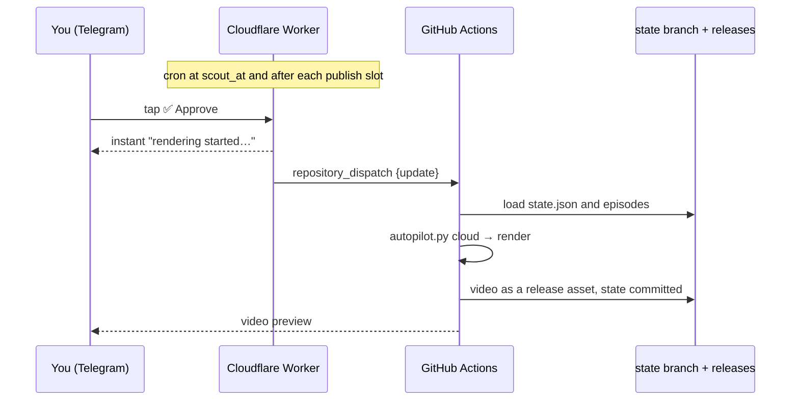

# Cloud mode: free, PC off

In cloud mode each channel runs in its **own private GitHub repo**. GitHub Actions does the writing and rendering,
and a free Cloudflare Worker turns Telegram taps into workflow runs. Nothing runs on your computer.



## Requirements

- Git, the [GitHub CLI](https://cli.github.com) (`gh`) and [Node.js](https://nodejs.org) (for `npx wrangler`)
- A free [Cloudflare](https://dash.cloudflare.com/sign-up) account. Open **Workers & Pages** once so your
  `workers.dev` subdomain is created.
- Telegram already working ([QUICKSTART.md](QUICKSTART.md#5-approve-from-telegram-5-min))

## One command

```bash
.venv/bin/python autopilot.py cloud-setup --channel mychannel
```

| Step | What it does |
|---|---|
| 1. Tools check | Finds `git`, `gh` and `npx`, and tells you how to install anything missing |
| 2. GitHub login | `gh auth login` if needed |
| 3. Repo + push | Creates the private repo `cloud.repo` and pushes the code. It **refuses** to push `.env`, `client_secret*.json`, models, data or videos |
| 4. Keys | Asks for anything missing. It runs `claude setup-token` for a long-lived Claude token and asks for a fine-grained GitHub token |
| 5. Secrets | Copies your keys into the repo's GitHub Actions secrets |
| 6. Worker | Deploys `cloud/worker.js` as `cloud.worker`, with your crons and site texts |
| 7. Webhook | Points Telegram at the Worker and starts a test run |

The command is safe to re-run, because finished steps are skipped. When asked for a GitHub token, create a
[fine-grained token](https://github.com/settings/personal-access-tokens/new) that covers **only the channel's repo**,
with **Contents: Read and write** and **Secrets: Read and write**.

If you use YouTube, run `autopilot.py youtube-test` once more afterwards. It copies the YouTube login into the
`YOUTUBE_TOKEN_JSON` secret.

✅ Within 1–3 minutes Telegram shows **☁️ Cloud status**. Runs are listed at `github.com/<you>/<repo>/actions`.

Stop the PC bot now: two bots must never answer the same Telegram chat. To go back to PC mode, run
`autopilot.py telegram-webhook --delete`, then `run_serve`.

## How it works

- **One event, one run.** Every Telegram tap and every cron starts one workflow run. The run loads state, handles
  the event, waits for its jobs and saves.
- **Runs queue, never overlap.** A concurrency group with `queue: max` makes sure two runs never write state at once.
- **State lives on a `state` git branch.** Videos are too big for git, so they are kept as pre-release assets
  (`vid-<id>`) and deleted after 21 days.
- **Only the steps a run needs.** [`cloud/classify.py`](../cloud/classify.py) decides whether a run needs the LLM
  (Node + Claude Code) and/or the renderer (FFmpeg, Chromium, voice model), so a `/status` tap costs seconds,
  not minutes.
- **Cron lives in the Worker.** GitHub's own `schedule:` trigger runs late or skips, so the Worker's cron triggers
  are used instead. They are generated from `schedule` in `channel.json` (UTC, via `schedule.utc_offset`).

## Secrets

| Secret | Needed for | Set by |
|---|---|---|
| `TELEGRAM_BOT_TOKEN`, `TELEGRAM_CHAT_ID` | always | cloud-setup |
| `CLAUDE_CODE_OAUTH_TOKEN` | the default writer | cloud-setup (`claude setup-token`) |
| `GH_SECRETS_TOKEN` | Instagram token refresh writes back to secrets | cloud-setup |
| `IG_USER_ID`, `IG_ACCESS_TOKEN` | Instagram | cloud-setup |
| `FB_PAGE_ID`, `FB_PAGE_TOKEN` | Facebook | cloud-setup |
| `YOUTUBE_TOKEN_JSON` | YouTube upload | `youtube-test` |
| `CF_ACCOUNT_ID`, `CF_API_TOKEN`, `PIXABAY_API_KEY`, `PEXELS_API_KEY` | background media | cloud-setup |
| `GEMINI_API_KEY`, `ANTHROPIC_API_KEY`, `YOUTUBE_API_KEY`, `AZURE_SPEECH_*`, `SARVAM_API_KEY` | optional | cloud-setup |

## Free limits

| Service | Free limit | Typical use at 1 video/day |
|---|---|---|
| GitHub Actions (private repo) | 2,000 min/month | ~900 min/month |
| Cloudflare Worker | 100,000 requests/day | ~20/day |
| Cloudflare Workers AI | ~150 images/day | ~12 per video |
| YouTube Data API | 10,000 units/day | one upload + one comment |

## Updating

- Code changes: commit and push to the channel repo.
- Changes to `cloud/worker.js` or the schedule: `autopilot.py worker-deploy`.
- New keys: add them to `.env` and re-run `cloud-setup`.
