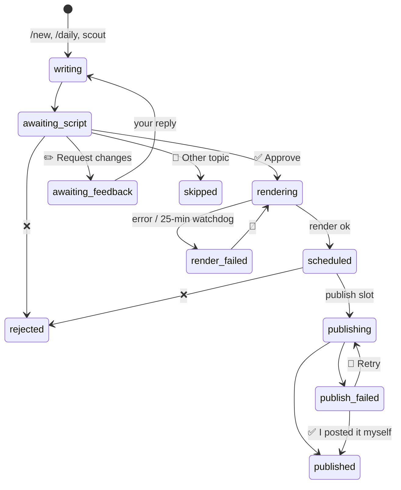

# Operations

Day-to-day use, what every button does, and what to do when something breaks.

## Daily routine (~2 minutes)

1. **`scout_at`.** The script arrives with its sources. Open one or two sources and check the numbers.
2. Tap **✅ Approve & render**, or, in auto mode, do nothing (tap **❌ Reject** if it's wrong).
3. **`publish_at`.** YouTube makes the video public, then the Reel and the Facebook post go out. Telegram shows
   the links.
4. **First hour after posting.** Reply to comments. Early replies are one of the cheapest reach boosts there is.

## Telegram buttons

| Button | Effect |
|---|---|
| ✅ Approve & render | Renders the video (PC ~1–6 min, cloud ~10–15 min), then books it for the next publish slot |
| ✏️ Request changes | The bot asks what to change. Your next message is the feedback, and the script is rewritten |
| 🔄 Other topic | Skips this one and drafts the next-best topic from the day's ranking |
| ❌ Reject | Drops the item. After a render it also deletes the YouTube copy already booked |
| 🚀 Publish now | Posts everywhere now instead of at the slot |
| 🔁 Re-render / Render again | Renders again, e.g. after a failure |
| 🔁 Retry publish / Retry Instagram | Tries the post again |
| ✅ I posted it myself | Marks the item published after a manual upload |

In auto mode (`publish.auto`), the scheduled script has only ❌ Reject. It renders and books itself.

## Telegram commands

| Command | Effect |
|---|---|
| `/new <topic>` | Writes a script on your topic |
| `/daily` | Runs the trend scout and drafts a script now |
| `/status` | The latest items and their state |
| `/stats` | Views, likes and watch time of the last 7 published videos (needs `YOUTUBE_API_KEY`) |
| `/render <id>` | Renders an item again |
| `/help` | The command list |

Taps are de-duplicated, so a double tap or a Telegram retry is ignored.

## CLI

```text
python autopilot.py demo                     render the built-in demo (no keys)
python autopilot.py new-channel <name>       create channels/<name> from the template
python autopilot.py check                    what is installed / which keys are missing
python autopilot.py trends                   today's raw topic candidates
python autopilot.py pick [-n 3]              AI-ranked topics
python autopilot.py write --topic "..."      write + validate one episode JSON
python autopilot.py render <episode.json>    render a video
python autopilot.py make --topic "..."       write + render, no approvals
python autopilot.py compare --topic "..."    two writers side by side
python autopilot.py serve                    the 24/7 bot (PC mode)
python autopilot.py publish <id> [--now]     publish an item
python autopilot.py cloud-setup              move to GitHub Actions
```

Add `--channel <name>` to any command when you have more than one channel.

## Item states



After a restart, half-finished items are marked failed, and Telegram gets a one-tap retry.

## Troubleshooting

| Symptom | Fix |
|---|---|
| Something is ❌ in `check` | Install or set what it names, see [SETUP.md](SETUP.md) |
| Render failed | Read `data/logs/render_<id>.log` (in the cloud: the failed run's *Logs* artifact), then tap 🔁 |
| Chromium missing | `python -m playwright install chromium`, or set `PW_CHROMIUM=/path/to/chrome`, or `render.engine: "classic"` |
| Script never arrives | Claude usage limit reached and no fallback set. Add `GEMINI_API_KEY` and `llm.fallback: "gemini"` |
| `invalid_grant` from YouTube | The OAuth app is still in *Testing* (7-day logins). Publish it to production, then run `youtube-auth` + `youtube-test` |
| Instagram failed on every host | `host-test` checks hosting, `ig-whoami` the token, `ig-limit` the quota (100 posts/24 h) |
| Video is too long or too short | Tune `CHARS_PER_SEC` for your language in `pipeline/validate.py`, or the length rule in `prompts/episode.md` |
| No reply in Telegram (cloud) | GitHub → Actions → the failed run's log. Worker side: Cloudflare → Workers → your worker → Logs |
| PC bot says "webhook is active" | Cloud mode is on. Use the cloud, or run `telegram-webhook --delete` to go back to PC |

Logs: `channels/<name>/data/logs/autopilot.log` on a PC, or the run log on GitHub.

## Maintenance

| What | When | How |
|---|---|---|
| Instagram token | every 60 days | Automatic (refreshed every 30 days) |
| GitHub fine-grained token | when it expires | New token, then `cloud-setup` |
| `CLAUDE_CODE_OAUTH_TOKEN` | ~1 year | `claude setup-token`, then `gh secret set CLAUDE_CODE_OAUTH_TOKEN` |
| YouTube login | doesn't expire while the OAuth app is in production | `youtube-auth` + `youtube-test` if revoked |
| Old render releases | 21 days | Automatic |
